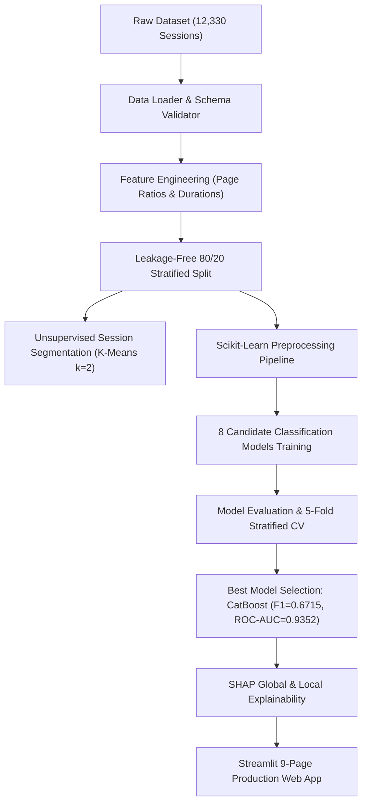

# Smart E-Commerce Customer Intelligence & Purchase Prediction System

A Machine Learning & Data Analytics project designed to analyze online shopping session behavior, perform unsupervised visitor session segmentation, predict real-time purchase conversion intention (`Revenue`), and extract evidence-based business insights.

---

## 📌 Project Overview
- **Dataset:** UCI Online Shoppers Purchasing Intention Dataset (12,330 sessions, 18 features).
- **Target Variable:** `Revenue` (Binary: `True` for purchase conversion, `False` for no purchase).
- **Class Distribution:** ~15.47% Purchase Conversion (`True` - 1,908 sessions), ~84.53% Non-Purchase (`False` - 10,422 sessions).
- **Core Objectives:**
  1. Perform leakage-free data preprocessing and domain-specific feature engineering.
  2. Segment shopping sessions using **K-Means**, **Gaussian Mixture Models (GMM)**, and **DBSCAN**.
  3. Build and evaluate 8 machine learning models (**Logistic Regression Baseline**, **Random Forest**, **XGBoost**, **LightGBM**, **CatBoost**, **Gradient Boosting**, **Stacking Ensemble**, **MLP Neural Network**).
  4. Explain tree-based predictions using **SHAP (SHapley Additive exPlanations)**.
  5. Provide an interactive **Streamlit** dashboard for executive decision-making and real-time session inference.

---

## 📐 End-to-End System Architecture



---

## 🏗️ Project File Structure

```
Smart_ECommerce_ML_Project/
│
├── data/
│   └── online_shoppers_intention.csv    # Raw UCI Dataset (12,330 rows, 18 columns)
│
├── src/
│   ├── __init__.py
│   ├── data_loader.py                   # Data validation, quality checks & schema loading
│   ├── preprocessing.py                 # Pipeline, Scaler, OneHotEncoder, Stratified Split
│   ├── feature_engineering.py           # Session ratios, Page value intensity, total views
│   ├── segmentation.py                  # K-Means, GMM, DBSCAN & Silhouette evaluation
│   ├── models.py                        # Model definitions & Hyperparameter tuning
│   ├── evaluation.py                    # Accuracy, Precision, Recall, F1, ROC-AUC, PR-AUC, CV
│   ├── explainability.py                # SHAP global & local explanation generation
│   └── business_insights.py             # Evidence-based recommendations & CRO strategy
│
├── models/
│   ├── preprocessing_pipeline.pkl       # Fitted Preprocessing Pipeline
│   ├── segmentation_model.pkl          # Trained Clustering Model & Profiles
│   ├── purchase_model.pkl               # Best Trained Classification Model (CatBoost)
│   ├── model_comparison_results.pkl     # All Evaluation Metrics & Curves
│   └── model_metadata.json              # Version & training timestamp metadata
│
├── reports/
│   ├── model_comparison_summary.csv     # Model evaluation benchmark CSV
│   └── segmentation_summary.csv         # Discovered session cluster profiles CSV
│
├── scratch/
│   └── test_app_workflow.py             # Automated end-to-end integration test suite
│
├── .streamlit/
│   └── config.toml                      # Production Streamlit UI Theme configuration
│
├── DEMO_GUIDE.md                        # Academic presentation & demo script
├── train.py                             # Master pipeline execution script
├── app.py                               # Interactive 9-Page Streamlit SaaS Application
├── requirements.txt                     # Python Dependencies
├── README.md                            # Comprehensive Documentation
└── .gitignore                           # Git ignore rules
```

---

## 🚀 Quick Start Guide

### 1. Prerequisites & Installation
Ensure Python 3.9+ is installed. Clone the repository and install required packages:

```bash
pip install -r requirements.txt
```

### 2. Run Training & Evaluation Pipeline
To execute data preprocessing, session segmentation, train all 8 machine learning models, evaluate metrics, and save model artifacts:

```bash
python train.py
```

### 3. Run Automated System Test Suite
To verify end-to-end backend functionality, data loading, preprocessing, predictions, and SHAP explainability:

```bash
python scratch/test_app_workflow.py
```

### 4. Launch Streamlit SaaS Web Application
To launch the interactive multi-page dashboard:

```bash
streamlit run app.py
```

The web application will open automatically at `http://localhost:8501`.

---

## 🌐 Cloud Deployment Instructions (Streamlit Community Cloud / PaaS)

## 🚀 Running the System Locally

### Option A: Modern Analytics SaaS Platform (Recommended)

1. **Start the ML Backend REST API (Flask on Port 5000):**
   ```bash
   # In terminal 1 (root directory)
   python server.py
   # Backend listens at http://localhost:5000
   ```

2. **Start the React + Vite Frontend (Port 5173):**
   ```bash
   # In terminal 2
   cd frontend
   npm install
   npm run dev
   # Access SaaS platform at http://localhost:5173
   ```

3. **Run Automated Test Suites:**
   ```bash
   # Backend Pytest Suite (18 endpoints):
   python -m pytest tests/test_api_endpoints.py

   # Frontend Vitest Suite (API client & formatters):
   cd frontend && npm test
   ```

### Option B: Legacy Streamlit UI (Fallback)
```bash
streamlit run app.py
```

---

## 🌐 Production Cloud Deployment

### 1. Backend REST API on Render
- **Spec:** Defined in [render.yaml](render.yaml).
- **Build Command:** `pip install -r requirements.txt`
- **Start Command:** `gunicorn server:app`
- **Environment Variables:**
  - `CORS_ORIGINS`: `*` (or your Vercel deployment URL)
  - `PYTHON_VERSION`: `3.10.12`

### 2. Frontend SaaS Platform on Vercel
- **Spec:** Configured in [vercel.json](vercel.json).
- **Framework Preset:** Vite
- **Root Directory:** `./` (or `frontend`)
- **Build Command:** `npm --prefix frontend run build`
- **Output Directory:** `frontend/dist`
- **Environment Variable:**
  - `VITE_API_URL`: Your Render backend service URL (e.g. `https://smart-ecommerce-ml.onrender.com`)

---

## 📊 Measured Evaluation Results

- **Session Segmentation:** Optimal clustering discovered via K-Means ($k=2$) evaluated against Silhouette Score (`0.4904`), Davies-Bouldin Index, and Calinski-Harabasz Score.
  - *Discovered Segments:* High-Intent Buyer Sessions, Casual Visitor Browsing Sessions.
- **Purchase Prediction Benchmark:**

| Model | Accuracy | Precision | Recall | F1-Score | ROC-AUC | PR-AUC | CV F1 (Mean) | CV ROC-AUC |
|---|---|---|---|---|---|---|---|---|
| **CatBoost (Selected)** | **0.8693** | **0.5535** | **0.8534** | **0.6715** | **0.9352** | **0.7482** | **0.6581** | **0.9315** |
| Gradient Boosting | 0.9037 | 0.7221 | 0.6257 | 0.6704 | 0.9352 | 0.7392 | 0.6520 | 0.9304 |
| Random Forest | 0.8828 | 0.5996 | 0.7565 | 0.6690 | 0.9292 | 0.7197 | 0.6783 | 0.9273 |
| LightGBM | 0.8693 | 0.5546 | 0.8377 | 0.6674 | 0.9349 | 0.7436 | 0.6567 | 0.9279 |
| Stacking Ensemble | 0.8644 | 0.5421 | 0.8586 | 0.6646 | 0.9348 | 0.7420 | 0.6562 | 0.9311 |
| XGBoost | 0.8669 | 0.5506 | 0.8115 | 0.6561 | 0.9350 | 0.7461 | 0.6613 | 0.9279 |
| Logistic Regression (Baseline) | 0.8439 | 0.5008 | 0.7984 | 0.6155 | 0.9112 | 0.6825 | 0.6059 | 0.9008 |
| MLP / Neural Network | 0.8951 | 0.7890 | 0.4503 | 0.5733 | 0.9058 | 0.6792 | 0.6339 | 0.9146 |

- **Model Explainability:** SHAP feature importance identifies **PageValues**, **ProductRelated Duration**, **ExitRates**, and **Month (Nov)** as the primary conversion drivers.

---

## 💡 Evidence-Based Strategic Recommendations

1. **Exit-Intent Offers for High Page-Value Sessions:** Target sessions exhibiting `PageValues > 10` with real-time exit popups or discount codes when exit intent is detected.
2. **Optimize UI/UX for High Bounce-Rate Landing Pages:** Simplify navigation and checkout friction for sessions categorized into bounce-prone clusters.
3. **Personalized Retargeting for Long-Duration Browsers:** Retarget visitors logging >500 seconds of product view duration who left without completing a purchase.
